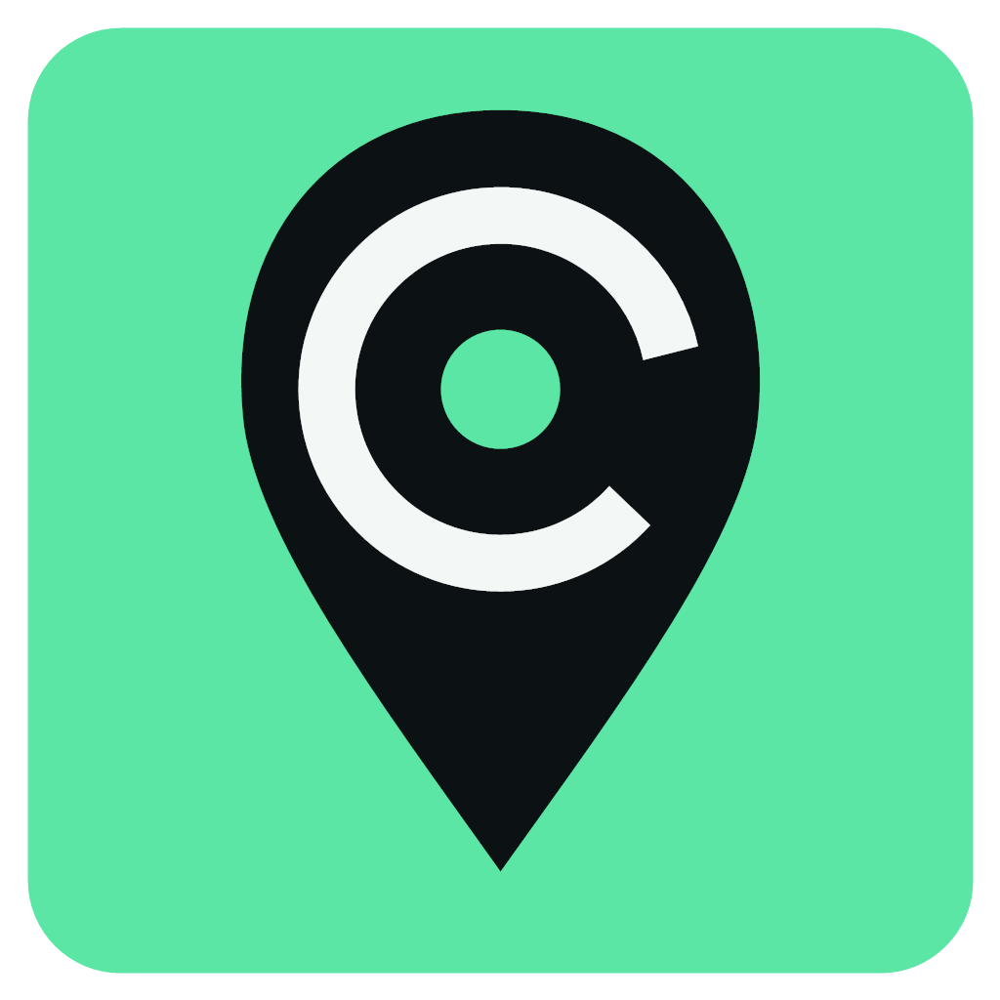
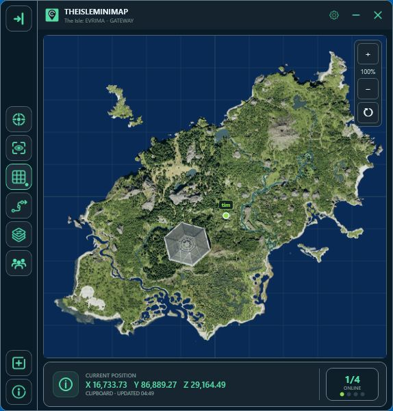

# TheIsleMinimap — The Isle: EVRIMA Gateway Minimap

**Introducing TheIsleMinimap: a Windows minimap for The Isle: EVRIMA’s Gateway map.**

TheIsleMinimap is built to be the most advanced minimap available for The Isle: EVRIMA, bringing configurable map layers, coordinate reading, personal map tools and online Squad features together in one app. It is developed by a single developer and regularly updated with new features, fixes and usability improvements.

Use it on **Windows 11 & Windows 10 (64-bit)** while playing Gateway on official or community servers. Choose Solo Lifetime for your own map tools, or a Squad plan to share your latest position with friends.

[Website](https://theisleminimap.com/) · [Plans](https://theisleminimap.com/pricing/) · [Complete tutorial](https://theisleminimap.com/tutorial/) · [Discord](https://discord.gg/WfxM6aEuWw)

## Current stable release

**Version 1.7.26 · Released October 27, 2026**

**Fast, accurate coordinate reading.** Update your marker when you press your Asset Location key.

This release introduced Solo Settings and personal pins, alongside leaderless squads. Check the [full changelog](https://theisleminimap.com/changelog/) for release details and newer updates.

## Giveaway: five Squad Monthly bundles

**Each giveaway key includes four licenses: one for you and three to share with friends.** Get 30 days of Squad access, starting when the giveaway key is redeemed. This giveaway access does not renew, and no purchase or payment method is needed.

**Please redeem only one giveaway key per group.** Whether you play as a pair, a trio or a group of four, one key covers your group. Your friends should accept your license invitations instead of claiming another giveaway key.

Five keys are available on a first-come, first-served basis. Each key can be redeemed once.

| Bundle | Giveaway key |
| --- | --- |
| 1 | `TIM-4WT8Y-HC2GP-9HVMH-C3UZ8` |
| 2 | `TIM-JUJQS-EVAX3-HJ2GS-MUVXP` |
| 3 | `TIM-FYS9Z-K6H57-2MHYD-DCPBN` |
| 4 | `TIM-PYSGD-PWSL8-KDL66-WDZRT` |
| 5 | `TIM-9FREY-3R5SC-KS8MV-RER84` |

### Redeem one key and invite your friends

1. Create a free [TheIsleMinimap account](https://theisleminimap.com/account/?action=signup), or sign in to your existing account.
2. Open **Account Portal > Licenses**, enter one key under **Redeem a giveaway key**, and select **Redeem key**.
3. In your bundle section, invite up to three friends using their TheIsleMinimap usernames. Each friend needs their own **free TheIsleMinimap account**.
4. Each friend opens **Account Portal > Licenses** and **accepts the invitation**. They then receive their own license and can reveal their own key using **View license key**.
5. Each person downloads the app from **Account Portal > Download** and activates it with their own key. To see each other on the map, create or join the same squad in **Settings > Squad Settings** using its private squad code.

All four licenses share the same expiry. Friends receive the remaining time when they accept, so invite them soon after redeeming. If a giveaway key has already been claimed, try another from the list.

**Missed this giveaway?** [Join us on Discord](https://discord.gg/WfxM6aEuWw). We’ll share more giveaway keys there from time to time.

## See your friends’ markers on Gateway

Join the same private squad to see each other’s latest captured positions on the map. Squads support **up to four players**, with individual marker colors, optional names and a shared destination pin.

**For example:** your friend presses **Tab** to show Asset Location in The Isle. Their app reads the coordinates and shares the new position, updating their marker on your minimap while you are connected to the same squad.

Squad updates are shared in real time as new positions are captured. The marker shows the **latest captured position**, rather than continuously following movement while Asset Location is hidden. Tab is the default; players who changed their in-game key can choose the matching reading key in the app. Automatic reading and clipboard updates are also supported.

[How position updates work](docs/position-updates.md) · [Private squads and sharing licenses](docs/private-squads.md)

## What you can do

| Feature | What it does |
| --- | --- |
| Gateway map layers | Choose useful references such as location names, landmarks, water, mud, patrol zones, migration zones and other resource layers. |
| Position updates | Read visible Asset Location coordinates when you press your game key, read them automatically while visible, or update through the clipboard. |
| Movement trail | Show the recent positions the app has captured. |
| Follow player and map grid | Keep your marker in view and use an optional grid for reference. |
| Solo Settings | Choose your marker color and place up to three personal colored pins. |
| Private squads | Share the latest captured positions with up to three friends, choose names and colors, and use a shared destination pin. |
| App appearance | Adjust size, opacity and mouse interaction to suit your setup. |
| Quick Access | Choose shortcuts for the features you use most. |
| Earplugs | Quickly reduce game audio using your chosen shortcut. |
| Streaming privacy | Control what you expose while streaming. |
| Setup and support | Follow Get started, open the reading quick guide, check service status and keep the app updated. |

[Explore the app features](docs/features.md)

## Get started

1. Create a free account at [theisleminimap.com](https://theisleminimap.com/account/?action=signup).
2. Choose a license, or accept a friend’s shared-license invitation on **Account Portal > Licenses**.
3. Open **Account Portal > Download**, install the Windows app and activate your key.
4. Follow **Get started** to choose your app preferences and position-update mode.
5. Open Gateway in The Isle and capture your first Asset Location coordinates.

[Installation and first position](docs/getting-started.md)

## Solo and Squad access

| Plan | Included licenses | Billing |
| --- | --- | --- |
| Squad Monthly | **4** — one for you and three to share | €5 per month; cancel anytime |
| Squad Quarterly | **4** — one for you and three to share | €10 every three months; cancel anytime |
| Squad Lifetime | **1** | €50 one-time |
| Solo Lifetime | **1** | €10 one-time |

Monthly and Quarterly subscribers invite friends from **Account Portal > Licenses**. Each friend accepts on their own account and uses their own key. Sharing a license does not automatically join someone to an in-app squad: join the same squad using its private code.

Each license allows one active Windows installation at a time. Online activation and periodic license checks are required, including with Solo Lifetime. See [current pricing and terms](https://theisleminimap.com/pricing/) before purchasing.

## Help and updates

- [Frequently asked questions](docs/faq.md)
- [Website support](https://theisleminimap.com/support/) and [private account tickets](https://theisleminimap.com/account/?action=tickets)
- [Discord guides and support](https://discord.gg/WfxM6aEuWw)
- [Changelog](https://theisleminimap.com/changelog/), [YouTube](https://www.youtube.com/@TheIsleMinimap) and [Follow on X](https://x.com/TheIsleMinimap)

Keep your own license key, squad code, passwords and payment details private.

## About this repository

This repository provides product information, screenshots and user guides. TheIsleMinimap is proprietary software; its application source code is not included here. See [content and artwork notices](NOTICE.md).

TheIsleMinimap is not affiliated with or endorsed by Afterthought LLC.
