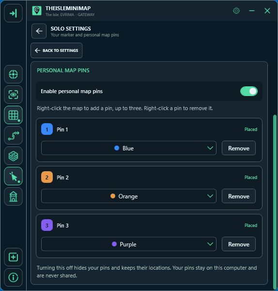
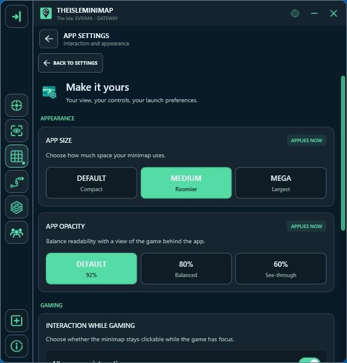

# Map features and app controls

[Back to the project overview](../README.md)

## Choose your view of Gateway

Use **Settings > Map Layers Settings** to choose the references you want on the map. General layers include location names, landmarks, drinking water, sanctuaries, mud areas, migration zones, patrol zones, air currents, roads and trails, salt licks and caves. Additional groups cover animals, plants and earthworks.

These layers are map references. They are not a live feed of every animal, resource or changing objective on your game server.

## Keep track of your captured positions

**Map Settings** contains movement trails, Follow player and the map grid. A trail connects recently captured positions; its detail depends on how often you update your coordinates.

Position-reading controls have their own **Position Updates** screen, including reading modes, your game key, reading-area setup and a quick guide.

## Personal pins for Solo players

In **Settings > Solo Settings**, choose your marker color and optionally enable personal map pins. Right-click the map to place the next pin, up to three. Each has its own color. Right-click a pin to remove it, or use its controls in Solo Settings.

Turning personal pins off hides them and keeps their saved locations. They stay on your computer and are never shared with a squad.

## Make the app comfortable while gaming

- Adjust app size and opacity.
- Choose how mouse interaction works while gaming.
- Select up to eight Quick Access shortcuts.
- Configure Earplugs and its keyboard shortcut.
- Use streaming privacy controls.
- Check service status and app updates.
- Enable local diagnostics when needed for troubleshooting.

For online marker sharing and a shared destination, see [private squads](private-squads.md). The [website feature overview](https://theisleminimap.com/features/) provides further details.
