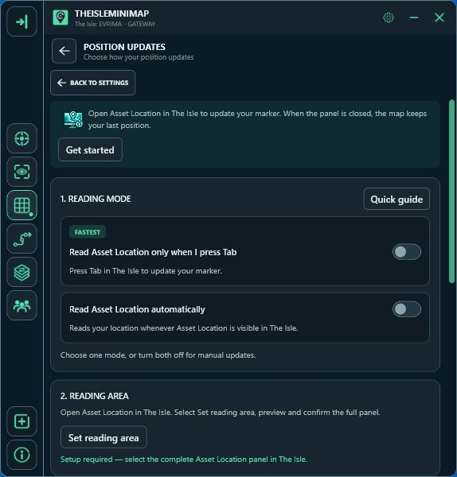
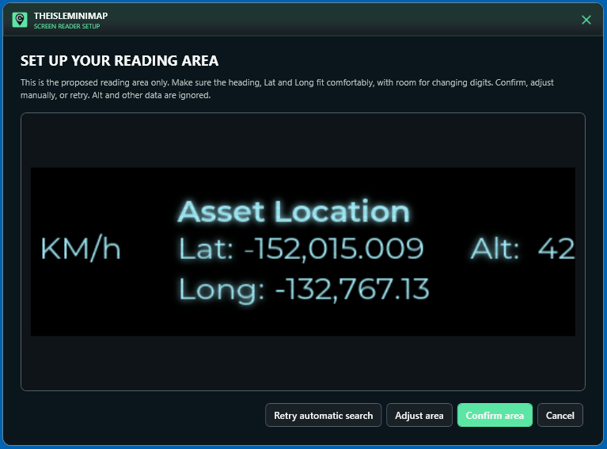

# Position updates in TheIsleMinimap

[Back to the project overview](../README.md)

The map uses **Lat and Long from Asset Location**, shown in The Isle’s in-game panel. The app can read those visible coordinates or receive them through the clipboard. Altitude is ignored.

## Choose your update method

Open **Settings > Position Updates**.

| Method | When your position changes |
| --- | --- |
| When I press Tab | Open Asset Location with your game key. The app reads the configured screen area after that key press. Tab is the default. |
| Automatically | Keep Asset Location visible so the app can capture ongoing coordinate changes. |
| Copy coordinates myself | Click Asset Location in the game to copy its coordinates, allowing the app to update through the clipboard. |

The two screen-reading modes are alternatives. You do not need to switch automatic reading on to use the key-triggered mode.

## Set the reading area

1. Open The Isle’s panel so **Asset Location**, **Lat** and **Long** are visible.
2. Start the reading-area setup and choose **Find automatically**.
3. Check that the proposed area contains the heading and both coordinate lines, with room for changing digits.
4. Confirm the area. Use the manual adjustment if needed.

## What your friends see

In a connected private squad, new captured positions are shared with the other members. When your friend opens Asset Location with Tab and the app successfully reads a new position, their marker updates on your map.

While the panel is hidden, the marker remains at its latest captured location. It does not imply your friend is still standing there. Update again when you need a fresh meeting point.

## If a position does not change

- Check that Asset Location is visible and the selected reading mode is enabled.
- If you changed the game’s panel key, choose the same key in Position Updates.
- Recheck your reading area after changing the game window, display resolution or scaling.
- Follow the administrator-permission guidance in Position Updates when required for your setup.
- Try a clipboard update to check that coordinates can be placed on the map.

Use **Settings > Position Updates > Quick guide** or the [complete tutorial](https://theisleminimap.com/tutorial/) for more help.
