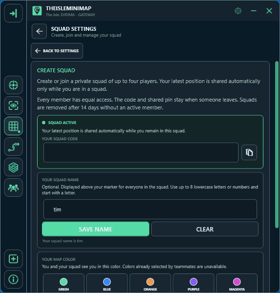

# Private squads and friends’ markers

[Back to the project overview](../README.md)

A private squad puts up to four players’ latest captured positions on the same Gateway map. Each player needs active Squad access and their own Windows app installation.

## Join the same squad

1. Activate your Squad license in the app.
2. Open **Settings > Squad Settings**.
3. Create a squad and share its private code with your friends, or join using a friend’s code.
4. Choose your marker color and optional name.
5. Capture your position from Asset Location. Other connected squad members receive the updated marker.

## Use a shared meeting point

Place a shared destination pin to identify the same spot for everyone in the squad. This helps when a description such as “near the river” could refer to several places. The shared pin is a destination reference, not automatic route guidance.

Friends’ markers update when their apps capture new coordinates, including after they press Tab to show Asset Location. They do not continuously track movement while those coordinates are hidden. [Read about position updates](position-updates.md).

## Squads do not need a leader

A squad can stay available when its creator leaves. Squads with no active member for 14 days are removed automatically. When a player’s Squad access ends, their slot is freed while remaining members keep the squad.

## Share Monthly or Quarterly licenses

Squad Monthly and Squad Quarterly each include **four licenses: one for the purchaser and three for friends**.

The purchaser opens **Account Portal > Licenses** and invites each friend by their TheIsleMinimap username. Each friend accepts the invitation on their own Licenses page and reveals their own key. They receive access for the remaining bundle period.

If you redeemed a [four-license giveaway bundle](../README.md#giveaway-five-squad-monthly-bundles), you can invite friends in the same way. Your friends need free accounts and should accept your invitations instead of redeeming another giveaway key. The giveaway term starts when the bundle key is redeemed, and all four licenses expire together.

Accepting a license invitation and joining an in-app squad are separate steps. After activation, join the same squad using its private code. Keep that code private.

Squad Lifetime includes one license, so friends need their own active Squad access.
